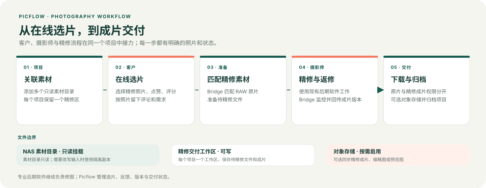
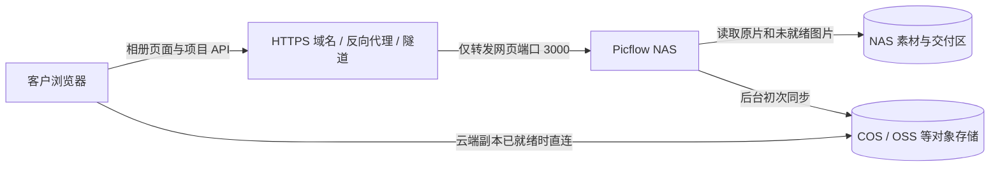

<div align="center">
  
</div>

# Picflow

Picflow 是面向摄影工作室的中文选片与精修交付平台。摄影师在工作台管理项目、NAS 素材和精修进度；客户通过网页相册选片、评论和下载照片。精修成片导出到指定目录后，内置同步服务会将新版本送回相册。

项目适合使用 Linux 或 NAS、通过 Docker Compose 自行部署的摄影团队。Picflow 与精修同步服务运行在同一个镜像中；Photoshop、Lightroom、像素蛋糕等后期工具通过共享文件夹工作，无需安装插件。

[部署到 NAS](#部署到-nas) · [外网访问与内网穿透](#外网访问与内网穿透) · [选片与精修](#选片与精修) · [对象存储](#对象存储) · [备份与升级](#备份与升级) · [开发与检查](#开发与检查)

## 解决了什么痛点

| 工作中的卡点 | Picflow 的处理方式 |
| --- | --- |
| 客户选片和修改意见散在聊天记录里，后期难对应到具体照片 | 客户在项目相册中选择精修照片、评分、点赞、评论或提出返修需求；摄影师在工作台按照片跟进。 |
| 样片、RAW 和项目交付目录容易混淆，素材路径变动后难以追踪 | 项目可关联多个只读素材目录，分别扫描和监控；Bridge 匹配 RAW 候选并提示同名冲突；精修文件集中在项目唯一的可写工作区。 |
| 成片导出、返修版本和上传状态要靠人工反复核对 | Bridge 监控成片目录、检查文件稳定性并回传版本；工作台汇总选片、返修和同步状态。 |
| 外地客户看图或下载受 NAS 上行带宽影响 | 按项目选择同步成片、缩略图或预览图；云端副本就绪后由客户浏览器直连对象存储。未同步原片仍由 NAS 提供。 |
| 原片、精修成片的下载权限和归档后的云端副本容易混为一谈 | 原片下载与交付照片下载分开控制；归档时可保留或删除云端副本，NAS 原片与交付工作区按既定规则保留。 |

## 核心流程



## 功能一览

- **客户相册**：浏览、筛选、评分、点赞、评论和选择精修，按项目设置下载照片或提交返修需求。界面支持简体中文和英文。
- **项目工作台**：管理项目、客户身份、照片分类、选片进度和精修需求；一个项目可关联多个 NAS 素材文件夹。
- **精修交付**：自动匹配 RAW 或客户上传源图，准备待精修文件；监控成片目录，并将不同版本回传到原照片记录。
- **下载管理**：查看逐文件进度和历史，在同一浏览器暂停或继续下载；同一客户身份可跨设备查看历史，但文件分块不跨设备共享。
- **可选云端交付**：将精修成片及按需选择的缩略图、预览图同步到 S3 兼容对象存储。备份目标也可复用已配置的对象存储连接。

Picflow 保留项目照片记录及客户反馈；同一照片的精修版本会更新预览。精修选择与颜色标签分别管理。

## 部署到 NAS

以下步骤适用于可运行 Docker Compose 的 Linux 主机和 NAS。路径与 UID/GID 请按实际设备填写；示例中的飞牛路径不适用于所有设备。

### 1. 准备目录和权限

在 NAS 上准备以下目录，并确认运行账号具备相应权限：

| 目录 | 用途 | 挂载权限 |
| --- | --- | --- |
| `Camera` | 样片与 RAW 等素材 | 只读；Picflow 和 Bridge 均需可读取 |
| `PixCakeDelivery` | 待精修文件、成片和历史快照 | 可写；Bridge 需可写入 |

`PixCakeDelivery` 可以位于 `Camera` 内，但必须作为独立的可写挂载；`Camera` 素材挂载仍保持只读。Compose 不会创建缺失的宿主机目录。

在仓库根目录复制配置模板：

```sh
cp .env.example .env
```

编辑 `.env`：

| 配置项 | 说明 |
| --- | --- |
| `LAN_BIND_IP` | NAS 局域网 IPv4。默认 `127.0.0.1` 只允许本机访问 |
| `PICFLOW_PORT` | 网页端口，默认 `3000` |
| `NAS_CAMERA_ROOT` | 已存在的 Camera 目录的宿主机绝对路径 |
| `NAS_RAW_ROOT` | 通常与 `NAS_CAMERA_ROOT` 相同；也用于兼容旧项目专属交付挂载 |
| `NAS_DELIVERY_ROOT` | 已创建的精修交付目录的宿主机绝对路径 |
| `NAS_CAMERA_UID`、`NAS_CAMERA_GID` | Camera 所有者的 UID/GID；Picflow 默认使用这组身份读取素材 |
| `PICFLOW_UID`、`PICFLOW_GID` | 可选，覆盖 Picflow 的运行身份 |
| `BRIDGE_UID`、`BRIDGE_GID` | Bridge 运行身份，须能读取素材并写入交付目录 |

完整配置及旧变量兼容说明见 [`.env.example`](.env.example)。不要将 `.env` 或其中的密钥发布到公开仓库。

### 2. 检查配置并启动

在仓库根目录执行：

```sh
# 检查 Compose 配置和挂载
docker compose -f compose.yaml -f compose.nas-camera.yaml config

# 构建镜像并启动
./scripts/build-picflow.sh
docker compose -f compose.yaml -f compose.nas-camera.yaml up -d
```

`docker compose config` 会输出解析后的环境变量；分享输出前请检查并移除密钥。

构建脚本默认使用 `linux/amd64`。在 ARM64 主机上，将构建命令改为：

```sh
PLATFORM=linux/arm64 ./scripts/build-picflow.sh
```

当前 [Compose 文件](compose.yaml)使用固定镜像标签 `picflow:1.6.7`；构建脚本从 Compose 读取标签。如果在其他 Docker 主机上构建，需先将同版本镜像转移并加载到 NAS，再启动服务。

### 3. 初始化项目

1. 打开 `http://NAS局域网IP:3000/setup`，创建管理员账号。如果修改了端口，使用配置的端口。
2. 新建项目，选择已挂载的样片文件夹。一个项目可以添加多个素材文件夹。
3. 在项目详情的「选片与精修进度」中选择「自动关联项目文件夹」，检查 RAW 匹配结果。系统会在统一交付根目录下为项目创建一个工作区。
4. 获取项目分享链接，交给客户选片。

健康检查地址为 `http://NAS局域网IP:3000/health`。首次初始化建议在局域网完成；外网分享需要为 Picflow 网页配置客户可访问的 HTTPS 地址，并验证匿名客户能打开分享页。

### 外网访问与内网穿透

客户在外网打开相册时，Picflow 网页和项目 API 仍由 NAS 提供。Picflow 不内置 DDNS、反向代理、VPN 或内网穿透服务；请按网络条件选择入口：

| 网络条件 | 入口方案 | Picflow 侧目标 |
| --- | --- | --- |
| 仅工作室局域网使用 | NAS 局域网地址 | 将 `LAN_BIND_IP` 设为 NAS 局域网 IPv4，客户设备连接同一局域网。 |
| 有公网 IP，且可配置路由器 | 自有域名 + HTTPS 反向代理 | 代理转发到 NAS 的 `3000` 端口；外部仅开放代理的 HTTPS 入口。 |
| 无公网 IP、处于运营商级 NAT，或无法配置入站端口 | NAS 或同网主机运行出站隧道客户端 | 将隧道目标指向可从客户端主机访问的 NAS 地址和 `3000` 端口；不需要把 Bridge 单独暴露。 |
| 仅团队成员访问，不开放客户公网链接 | VPN | 团队设备加入同一 VPN；客户若不加入 VPN，就不能通过此路径访问相册。 |



- 有公网 IP 时，可将自有域名指向反向代理，由代理终止 HTTPS 并转发到 Picflow 网页端口 `3000`。没有公网 IP 时，可由 NAS 或同网设备运行出站隧道客户端，再将客户访问域名转发到 Picflow。隧道客户端和其访问策略由部署者单独管理。
- 在「设置 → 常规」将「客户访问地址」设为客户实际使用的 HTTPS 域名。代理应保留正确的 Host 和 HTTPS 转发信息；完成后用手机蜂窝网络等外部网络打开分享链接，验证无需 NAS 管理员登录即可访问客户页。
- 不同容器内的 `127.0.0.1` 指向各自容器，不是 NAS 或 Picflow 容器。外部代理需使用可路由的 NAS 地址或共享的容器网络。
- 只向客户网络发布网页服务；不要映射 Bridge 的 `8080` 端口。`8080` 仅在容器内回环监听，工作台通过 Picflow 后台访问 Bridge。
- 内网穿透只承载 Picflow 网页、API，以及尚未转到云端的图片流量；它不会替代对象存储。云端图片副本就绪后，浏览器直接从对象存储读取，不经过 NAS 隧道；RAW 原片始终由 NAS 提供。首次向云端同步仍要消耗 NAS 上行带宽。

飞牛 FN Connect 或其他隧道的匿名访客能力、带宽和访问限制会因服务配置而异，应从真实外网单独验证；管理端能打开不代表客户分享链接已验收。

### 添加其他素材根目录

项目界面只能选择 Docker 已挂载的目录，不能直接访问任意宿主机路径。需要使用 Camera 以外的目录时：

1. 复制 [`compose.extra-material-root.yaml.example`](compose.extra-material-root.yaml.example) 为 `compose.extra-material-root.yaml`。
2. 在 `.env` 中设置 `NAS_MATERIAL_ROOT_STUDIO`，按示例配置只读挂载及稳定的容器别名。
3. 后续 Compose 命令都包含这个文件，并在变更挂载后重建服务容器。

例如，检查和启动时使用：

```sh
docker compose -f compose.yaml -f compose.nas-camera.yaml -f compose.extra-material-root.yaml config
docker compose -f compose.yaml -f compose.nas-camera.yaml -f compose.extra-material-root.yaml up -d
```

额外素材目录同样需要授予 Picflow 和 Bridge 读取权限。不要挂载整个 NAS、宿主机根目录、应用数据卷或 Docker Socket。已被项目使用的容器别名和目录层级应保持稳定；更换目录前先备份并确认文件对应关系。完整的多目录关联、扫描与迁移边界见[素材目录关联说明](docs/nas-material-folder-associations.md)。

## 选片与精修

1. **客户选片**：客户通过分享页选择需要精修的照片，并可填写评论或需求。
2. **准备源文件**：摄影师在工作台检查匹配结果；Bridge 将匹配的 RAW 或客户上传源图放入 `03_SELECTED_RAW`。
3. **进行后期**：摄影师切换项目阶段，通过 SMB 等方式将待精修文件导入后期软件。
4. **导出成片**：首次导出到 `04_FINAL/V1`；返修按工作台提示导出到该照片的下一版本目录。
5. **回传与返修**：Bridge 等待成片稳定并检查内容，回传新版本；摄影师在需求卡片处理返修和追加选片。

成片支持 JPG、JPEG 和 PNG，导出时须保留源文件名主干，例如 `DSC00125.ARW` 对应 `DSC00125.JPG`。客户上传文件可能使用不同的工作文件名，应以工作台显示的名称与导出目录为准。

项目从未进入精修阶段时，撤回选择会清理 Bridge 创建且校验未变的待精修副本；进入过精修阶段后，即使阶段退回，未交付照片撤回选择也不会自动删除可能正在处理的工作副本。对已交付照片，客户可选择删除或保留成片：删除会恢复样片或上传原图，并清理该照片对应的交付成片和 Bridge 快照；保留则保留成片预览并移除工作区中的 RAW 关联。NAS 原片不受这些操作影响。

### 素材与交付目录

建议将样片与 RAW 放在同一拍摄目录，并使用相同文件名主干。关联 `02_PROOF` 时，Bridge 按约定匹配同级 `01_RAW`：

```text
Camera/
├── 26-10-04/
│   ├── 01_RAW/                    # RAW 原片，只读
│   │   └── DSC00125.ARW
│   └── 02_PROOF/                  # 样片，只读
│       └── DSC00125.JPG
└── PixCakeDelivery/               # 单独可写挂载
    └── 26-10-04/                  # 项目唯一交付工作区
        ├── 03_SELECTED_RAW/       # 待精修文件
        ├── 04_FINAL/
        │   ├── V1/                # 首次成片
        │   └── V2/                # 返修成片
        └── 05_HISTORY/            # Bridge 历史快照
```

支持的 RAW 扩展名为 `.ARW`、`.CR3`、`.CR2`、`.NEF`、`.RAF`、`.DNG`、`.ORF` 和 `.RW2`。不同素材文件夹中的同名照片不会仅按文件名合并。多个 RAW 目录存在同主干候选时，Bridge 会提示冲突，需人工确认。

每个素材文件夹可以分别扫描、暂停或恢复监控。停用来源不会删除已导入照片或 NAS 原文件；素材目录不可用时，其他来源仍可继续工作。NAS 引用照片依赖原文件路径，关联后不要移动、重命名或删除源文件。客户上传的非 RAW 图片可直接作为待精修源图，不需要匹配 RAW。

默认 `RAW_MATERIALIZE_MODE=auto`：只对只读原始 inode 尝试 hardlink，再尝试 reflink，最后复制；不使用符号链接。如果后期软件会改写导入文件，设置为 `copy`，使用隔离副本。

<details>
<summary>精修同步参数</summary>

| 变量 | 默认值 | 说明 |
| --- | --- | --- |
| `POLL_SECONDS` | `30` | Bridge 周期轮询间隔，单位为秒 |
| `STABLE_SECONDS` | `10` | 成片文件稳定等待时间，单位为秒 |
| `MAX_FINAL_BYTES` | `104857600` | 单个成片大小上限，100 MiB |
| `HISTORY_KEEP` | `3` | 每张照片保留的最近 Bridge 交付快照数；不限制 `04_FINAL/Vn` 目录 |
| `RAW_MATERIALIZE_MODE` | `auto` | 待精修文件物化方式；`copy` 强制复制 |

Bridge 使用文件事件和周期扫描检测成片，并按 SHA-256 内容去重。相同内容不会重复上传；返修只扫描照片当前待交付的版本目录，失败或待上传任务不计入成功版本数。

</details>

## 对象存储

对象存储是按需启用的交付加速层，不是 Picflow 的必需组件，也不会替代 NAS 原片。适合客户分布在外地、NAS 上行带宽有限、多人同时浏览或下载的场景；客户读取已就绪的云端图片时由浏览器直连存储，可减少穿透链路和 NAS 出口压力。局域网内使用、客户数量少且 NAS 网络稳定时，可继续全部使用 NAS，避免额外存储、请求和流量费用。

| 需要改善的环节 | 对应设置 | 访问路径与边界 |
| --- | --- | --- |
| 精修交付下载慢 | 精修成片自动同步；可选「精修成片下载强制走云端」 | 成片同步就绪后由浏览器直连对象存储；强制云端时，副本未就绪就等待，不回退到 NAS。原片仍从 NAS 下载。 |
| 首屏缩略图慢 | 同步缩略图到云端 | 缩略图就绪后浏览器直连对象存储；未开启或尚未就绪的内容仍由 NAS 提供。 |
| 打开查看器预览慢 | 同步预览图到云端 | 预览图就绪后浏览器直连对象存储；未开启或尚未就绪时沿用 NAS 路径。此开关不同于「查看器使用预览图」设置。 |

设置页可配置新项目默认值；创建或编辑项目时，可分别调整成片同步、强制云端下载、缩略图同步和预览图同步。缩略图、预览图默认仍由 NAS 提供。对象存储开关启用后，系统检查并生成/上传当前照片所需规格；初次补齐已有项目会形成后台队列，NAS 仍提供未就绪副本。图片变体同步不会上传 RAW 原片。

### 腾讯云 COS、阿里云 OSS 与 S3 兼容服务

对象存储设置使用 S3 API。腾讯云 COS 和阿里云 OSS 可按各自的 S3 兼容 Endpoint 接入；其他服务需满足相应 API 能力，并通过设置页的连接、写入和清理测试。常见配置如下：

| 服务 | Endpoint 示例 | Region / Bucket 提示 | Path-style |
| --- | --- | --- | --- |
| 腾讯云 COS | `https://cos.<地域>.myqcloud.com` | Region 使用地域代码，如 `ap-guangzhou`；Bucket 格式为 `名称-APPID` | 关闭，使用 Virtual-hosted style |
| 阿里云 OSS | `https://s3.oss-<地域>.aliyuncs.com`，如 `https://s3.oss-cn-hangzhou.aliyuncs.com` | Endpoint 与 Bucket 必须位于同一地域；按控制台显示填写 Region 和 Bucket | 关闭，使用 Virtual-hosted style |
| AWS S3 | Endpoint 留空 | 填写 Bucket 所在 Region 与名称 | 通常关闭 |
| MinIO 等自建服务 | 填写服务端提供的 S3 Endpoint | 使用服务端配置的 Region、Bucket 和凭据 | 仅在服务端要求时开启 |

使用专用访问密钥并仅授予所需 Bucket 的列举、读取、写入和删除权限。保存配置后先运行「测试连接与写入」；该测试会在目标前缀写入并删除临时对象。更换 Endpoint、Region、Bucket 或对象前缀前，先处理既有云端副本和备份目标，避免应用指向新位置后旧对象无人管理。

### 让客户浏览器安全直连

云端缩略图、预览图和成片由客户浏览器直接请求对象存储，不经过 Picflow 后端。配置存储桶 CORS 时，应允许客户访问地址的实际 Origin、`GET`/`HEAD` 和 `Range` 请求，并暴露 `ETag`、`Content-Range`、`Content-Length`、`Content-Type`。对象存储 Endpoint 必须能从客户设备访问；客户页面使用 HTTPS 时，Endpoint 也必须使用 HTTPS。不要为省事开启整个 Bucket 的匿名公共读；按应用生成的访问方式和存储服务策略配置访问。

对象存储加速的是已经上传且就绪的副本。第一次上传由 NAS 发起，仍消耗 NAS 上行带宽；设置页可调整图库图片上传并发（1–8，默认 4）和后台上传速率上限，以兼顾补传速度与日常 NAS 网络。若队列尚未完成，缩略图和预览图按项目设置从 NAS 回退；成片只有在开启强制云端时才会等待，不走 NAS 降级路径。

对象存储也可作为应用备份目标，但照片同步与备份是两种用途：照片同步用于客户浏览和下载；备份保存的是应用恢复所需的数据。不要把 NAS 原片、Picflow 数据卷或精修交付工作区的独立备份责任交给图库同步开关。`OBJECT_STORAGE_ENCRYPTION_KEY` 是可选的独立凭据加密密钥；如设置，升级和恢复时必须保持一致。留空时，应用使用 `JWT_SECRET` 派生密钥；备份和恢复时需保留相应应用配置。

## 客户下载管理

客户可在相册右下角打开「下载管理」，查看逐文件进度、暂停或继续下载，并查看历史记录。文件准备完成后会提示并交给浏览器保存；浏览器可能要求确认，页面提示不代表系统已确认文件落盘。

同一项目中选择同一个已有客户身份，可在不同设备查看下载历史；另一台设备重新下载时从头接收文件。续传分块保存在当前站点和浏览器，清理站点数据、切换浏览器或关闭隐私窗口可能使本地分块丢失。文件版本改变后需重新下载，不能拼接新旧版本。[查看下载管理说明](docs/customer-download-manager.md)

## 备份与升级

升级前停止旧容器，备份并验证以下内容：

- Picflow 数据卷 `/data`、Bridge 状态卷 `/bridge-data`。
- `.env`、Compose 文件、素材挂载别名与精修交付目录。
- 对象存储凭据加密所需的密钥及相应配置；NAS 原片由独立备份方案保护。

从包含「相册里的人」功能的旧版本升级时，迁移会清理派生人物索引、识别设置和自动分类标记；项目、照片、评论、评分和手动分类会保留。

物理数据卷名仍为 `phoflow_data` 和 `phoflow_bridge_data`，以兼容旧安装。升级时应确认容器使用原有数据卷和素材挂载，不要将空卷当作旧数据。**不要使用 `docker compose down -v` 执行升级：`-v` 会删除应用数据卷。**

数据库和 Bridge 状态按向前迁移维护。回退时需恢复升级前相互匹配的应用数据、Bridge 状态和交付目录；仅换回旧镜像可能造成状态不一致。详细操作见[运行架构与升级边界](docs/upgrade-and-data.md)。

设置页可检查 `PICFLOW_GITHUB_REPOSITORY` 指定仓库的正式 GitHub Release，默认仓库为 `Aanlik/Picflow`；检查不会自动下载或安装更新。如果 NAS 需要代理才能访问 GitHub，可在 `.env` 设置 `HTTPS_PROXY`，并按需设置 `HTTP_PROXY` 和 `NO_PROXY`。

## 常见问题

**局域网无法打开工作台？**

确认 `LAN_BIND_IP` 为 NAS 实际局域网 IPv4，而不是默认的 `127.0.0.1`；检查端口和 NAS 防火墙。查看服务日志：

```sh
docker compose -f compose.yaml -f compose.nas-camera.yaml logs --tail=100 picflow
```

**找不到素材或无法准备待精修文件？**

检查宿主机目录是否存在、Compose 是否挂载到预期别名，以及 Picflow 和 Bridge 运行账号是否有读取权限。再检查交付目录写权限、项目来源和 RAW 文件名。不要为素材挂载开启写权限。

**成片没有回传？**

检查文件名主干、格式、大小以及工作台显示的 `Vn` 导出目录；等待文件稳定后查看同步异常，并按需要执行同步、重扫或重试。后期工具未显示新增待精修文件时，刷新或重新导入目录。

**客户无法从云端下载或浏览？**

先检查项目云端同步状态与对象是否就绪，再检查客户设备能否访问 Endpoint、存储桶 CORS 和 TLS 证书。强制云端下载仅约束已交付精修成片；不要通过公开访问密钥解决连接问题。

**内网穿透后，客户是否还会占用 NAS 上行带宽？**

网页和 API 仍经 Picflow 所在 NAS；云端副本就绪后的缩略图、预览图或成片由客户浏览器直连对象存储。尚未同步的图片和原片仍会经过 NAS。首次上传云端也由 NAS 发起。

## 运行结构

当前 Compose 使用单体镜像，内置 Picflow、SQLite 和 Bridge，不需要单独部署 PostgreSQL、Redis 或 Bridge 容器。Bridge 只监听容器回环地址 `127.0.0.1:8080`，工作台通过 Picflow 后台代理访问，无需单独的 Bridge 账号或 Public API Token。

| 容器内位置 | 用途 |
| --- | --- |
| `/data` | Picflow 数据库、上传文件、预览、缩略图、归档及配置 |
| `/bridge-data` | Bridge 配置、绑定、版本与任务状态 |
| `/external-media/<别名>` | Camera 和其他显式配置的只读素材根目录 |
| `/delivery` | 可写的精修交付根目录 |

旧项目专属交付挂载可按 `.env.example` 中的 `PROJECT_DELIVERY_MOUNTS` 等兼容配置保留；新项目在统一交付根目录下创建工作区。

## 开发与检查

前端使用 React、TypeScript 和 Vite；后端使用 Node.js 和 Express；Bridge 使用 Python 和 FastAPI。主要代码分别位于 `frontend/`、`backend/` 和 `bridge/`。

本地检查需要 Node.js 22.12 或更新版本、Python 3.12 或更新版本及 uv；构建统一镜像需要 Docker。在仓库根目录执行：

```sh
# 中文资源检查
node scripts/check-zh-cn.mjs
node scripts/check-locale-usage.mjs

# 前端
npm ci --prefix frontend --legacy-peer-deps
npm --prefix frontend run build:check
npm --prefix frontend run lint

# 后端
npm ci --prefix backend
npm --prefix backend run lint

# Bridge 依赖与统一镜像
uv sync --directory bridge --frozen --python 3.12
./scripts/build-picflow.sh
```

[统一工作流](.github/workflows/unified.yml)包含中文资源检查、前后端静态检查、依赖审计和镜像构建。正式发布流程见 [RELEASING.md](RELEASING.md)。

## 项目来源与许可

Picflow 基于 [PicPeak/picpeak](https://github.com/PicPeak/picpeak) 定制并独立维护。仓库来源记录中的上游基线为 `v3.134.1`、原始 stable 提交为 [`5fc54d9a5e17a7f054c926922a6f820f3c98eda2`](https://github.com/PicPeak/picpeak/commit/5fc54d9a5e17a7f054c926922a6f820f3c98eda2)；该信息用于追溯来源，不表示当前代码与上游版本相同。PixCake Bridge 通过 Git subtree 导入 `bridge/`，导入基准为 `0746de8`，保留[独立许可文件](bridge/LICENSE)。

感谢 PicPeak 原作者及贡献者。仓库保留上游 MIT 许可和版权声明，见 [LICENSE](LICENSE)；再分发时还需核对依赖、字体及其他资源的许可。Picflow 不自动同步或合并官方 PicPeak 更新，也不承诺提供上游全部功能。详细记录见[代码来源记录](docs/source-provenance.md)。

## 进一步阅读

- [客户下载管理与续传边界](docs/customer-download-manager.md)
- [运行架构与升级边界](docs/upgrade-and-data.md)
- [Bridge 内部服务](bridge/README.md)
- [中文界面维护与翻译检查](docs/zh-CN-maintenance.md)
- [版本记录](CHANGELOG.md) · [发布流程](RELEASING.md) · [环境变量示例](.env.example)
